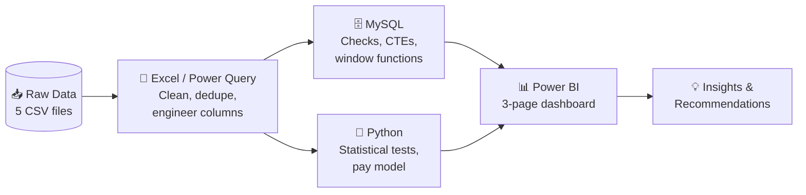

### From raw freelancer data to a decision-ready pay and platform dashboard

    

---

## 🧭 Quick Links for Recruiters

> Short on time? Everything you need is one click away.

| 📁 What | 🔗 Open | What you will see |
| --- | --- | --- |
| 📊 **Power BI Dashboard** | [`05_Dashboard/GigEarningOptimizer.pbix`]([05_Dashboard/GigEarningOptimizer.pbix](https://github.com/DarshChoudhary-09/Gig-Optimization-Analysis/blob/main/GigEarningOptimizer.pbix)) · [Screenshots](#dashboard) | 3-page interactive report with slicers, a what-if fee slider and Key influencers |
| 🗄️ **SQL Code** | [`03_SQL/`](03_SQL) · [SQL walkthrough](#sql) | Data-quality checks, CTEs, window functions, views and a stored procedure |
| 🐍 **Python Notebook** | [`04_Python/gig_analysis.ipynb`](04_Python/gig_analysis.ipynb) · [Python walkthrough](#python) | Statistical tests, bootstrap intervals and a pay model |
| 📗 **Excel Workbook** | [`02_Excel/GigEarningOptimizer_Excel.xlsx`](02_Excel/GigEarningOptimizer_Excel.xlsx) · [Data dictionary](#excel) | Power Query cleaning, pivot tables and an Excel dashboard |
| 🧹 **Cleaned Datasets** | [`01_Data/`](01_Data) | Analysis-ready CSV files used by every tool |

---

## 📑 Table of Contents

1. [Project at a Glance](#at-a-glance)
2. [Business Problem](#business-problem)
3. [Data Sources](#data)
4. [Key Findings](#key-findings)
5. [Dashboard](#dashboard)
6. [Project Workflow](#workflow)
7. [SQL: Checks and Analysis](#sql)
8. [Python: Statistics and Modeling](#python)
9. [Excel: Cleaning and Data Model](#excel)
10. [What This Means for a Freelancer](#actions)
11. [Challenges I Solved](#challenges)
12. [Repository Structure](#structure)
13. [How to Reproduce](#reproduce)
14. [Limitations](#limitations)
15. [About Me](#about)

---

<a id="at-a-glance"></a>
## 🎯 Project at a Glance

| 👥 Freelancer Profiles | 🧾 Earnings Records | 💰 Earnings Analysed | 💵 Avg Hourly Rate |
| --- | --- | --- | --- |
| **500** | **1,950** | **$9.78M** | **$97.15** |

| 📢 Job Postings | 🧩 Skill Rows | 🌍 Regions | 📅 Postings Period |
| --- | --- | --- | --- |
| **52,977** | **263,240** | **7** | **Dec 2023 – Feb 2024** |

**In one sentence:** I cleaned five freelancer datasets in Excel Power Query, tested what drives pay and whether platform choice changes earnings using MySQL and Python, and built a 3-page Power BI dashboard that shows which factors lift hourly rate and how net earnings change with platform fees.

---

<a id="business-problem"></a>
## 💼 Business Problem

A freelancer choosing where to work, how to price and which platform to use usually relies on anecdotes and platform marketing. There is little evidence about which factors actually change what a freelancer earns, and whether the platform matters once fees are taken into account.

**Objective:** find what drives freelancer pay and test whether platform or job category changes earnings, so freelancers can price and position themselves with evidence.

**Business questions answered**

1. What drives a freelancer's hourly rate?
2. How does pay change with experience level and job category?
3. Do platform or job category change earnings, or is the difference just noise?
4. How sensitive are net-earnings rankings to the platform-fee assumption?
5. What share of freelancers lose money after fees and marketing spend?

| Term | Definition |
| --- | --- |
| **Hourly rate** | The freelancer's rate in USD per hour (workers dataset) |
| **Gross earnings** | `earnings_usd` per freelancer (transactions dataset) |
| **Net earnings (what-if)** | `earnings × (1 − fee %) − marketing spend`, with the fee set by a slider |
| **Net negative** | Net earnings below zero after the assumed fee and marketing spend |
| **Eta-squared** | The share of variation in a measure that a factor explains (0 to 1) |

> **Scope:** data cleaning, SQL analysis, statistical tests, a pay model and a 3-page Power BI dashboard. Predicting earnings for individual new freelancers and any claim about cause and effect are out of scope.

---

<a id="data"></a>
## 📦 Data Sources

| Dataset | Rows | Description | Used for |
| --- | --- | --- | --- |
| `workers` | 500 | Freelancer profiles: category, skills, region, experience, hourly rate | Worker pay analysis |
| `transaction_clean` | 1,950 | Freelancer earnings by platform, with marketing spend | Platform and net-earnings analysis |
| `gigs_clean` | 52,977 | Upwork job postings, Dec 2023 to Feb 2024 | Job postings card, SQL and Python analysis |
| `gigs_skills` | 263,240 | One row per job and skill | SQL and Python analysis |
| `time_tracking_clean` | 10,000 | Salaried employee records | Benchmark in SQL and Python only |

Sources: `[add where each dataset came from and its license]`.

---

<a id="key-findings"></a>
## 🔍 Key Findings

> All figures are calculated from the 500 worker profiles and the 1,950 earnings records.

**Average hourly rate by region**

| Region | Workers | Avg Hourly Rate |
| --- | --- | --- |
| 🌍 **Western Europe** | 72 | **$152.1** |
| 🌎 **North America** | 63 | **$142.1** |
| Middle East | 81 | $115.6 |
| Asia Pacific | 59 | $84.6 |
| Eastern Europe | 84 | $73.3 |
| Latin America | 69 | $64.6 |
| 🌍 **Africa** | 72 | **$51.4** |

**Average hourly rate by experience level**

| Level | Workers | Avg Hourly Rate |
| --- | --- | --- |
| Junior | 46 | $45.5 |
| Mid | 175 | $82.4 |
| Senior | 279 | $114.9 |

**Earnings by platform (transactions)**

| Platform | Freelancers | Avg Earnings | Avg Net (assumed fees) | Avg Net (flat 10% fee) |
| --- | --- | --- | --- | --- |
| Fiverr | 391 | $5,068 | $3,819 | $4,326 |
| Freelancer | 386 | $5,039 | $4,281 | $4,281 |
| PeoplePerHour | 358 | $5,031 | $4,282 | $4,282 |
| Upwork | 420 | $5,029 | $4,280 | $4,280 |
| Toptal | 395 | $4,923 | $4,170 | $4,170 |

**What the data says**

- 🌍 **Region is the strongest driver of hourly rate.** It explains about **47%** of the variation, and Western Europe pays about **3×** what Africa does ($152 vs $51). Experience level explains about 18%, job category 9%, platform 3% and education 1%.
- 📈 **Pay rises sharply with experience.** Senior workers average about **2.5×** Junior workers ($114.9 vs $45.5). Only 46 workers are Junior, so treat that group with care.
- ⚖️ **Platform does not significantly change earnings.** Average earnings are almost the same on all five platforms ($4,923 to $5,068). A one-way ANOVA gives **p = 0.97**, and bootstrap 95% confidence intervals overlap heavily, so no platform "winner" is claimed. Job category also shows no significant effect (p = 0.53).
- 💸 **Net-earnings rankings depend on the fee assumption.** With one flat fee on every platform, average net earnings are about **$4,267 at 10%** and **$3,766 at 20%**. Fiverr ranks last under the assumed fees only because its assumed fee is 20%, not because of performance.
- ⚠️ **About 3.1% of freelancers (61 of 1,950) end up with negative net earnings** once platform fees and marketing spend are subtracted.
- 🤖 **A regression and a random forest predict hourly rate with a cross-validated R² of about 0.68**, against about 0 for a baseline that guesses the average. Region and years of experience matter most. `[Keep this line only if you ran the models.]`

---

<a id="dashboard"></a>
## 📊 Dashboard

📂 **File:** [`05_Dashboard/GigEarningOptimizer.pbix`](05_Dashboard/GigEarningOptimizer.pbix) (open with the free [Power BI Desktop](https://powerbi.microsoft.com/desktop/))

The report has three pages: **Overview**, **Worker Pay** and **Platforms and Earnings**.

### Overview


### Worker Pay


### Platforms and Earnings


**Interactive features**

- 🎛️ **Three slicers** on the Overview: Region, Experience level and Platform
- 🧮 **KPI cards:** workers, average hourly rate, total earnings and job postings
- 🔎 **Key influencers visual** that ranks what lifts hourly rate (region comes out first)
- 🔵 **Scatter chart** of years of experience against hourly rate, coloured by experience level
- 🎚️ **What-if fee slider** that recalculates net earnings from 0% to 30%
- 🔥 **Heat-map matrix** of average net earnings by job category and platform
- 📊 **Gross vs net earnings** by platform, side by side
- ⚠️ **Net Negative %** card for freelancers who lose money after costs

**📐 DAX measures used (click to expand)**

<details>
<summary>Show measures</summary>

```
Avg Hourly Rate = AVERAGE(workers[hourly_rate_usd])

Total Earnings = SUM(transaction_clean[earnings_usd])

Avg Net (what-if) =
AVERAGEX(
    transaction_clean,
    transaction_clean[earnings_usd] * (1 - [Fee Assumption Value] / 100)
        - transaction_clean[marketing_spend_usd]
)

Net Negative % =
DIVIDE(
    CALCULATE(COUNTROWS(transaction_clean), transaction_clean[is_net_negative] = 1),
    COUNTROWS(transaction_clean)
)
```
</details>

---

<a id="workflow"></a>
## 🔄 Project Workflow



| Step | Tool | Output |
| --- | --- | --- |
| 1. Clean | Excel / Power Query | Analysis-ready tables |
| 2. Analyse | MySQL Workbench | Checks, queries, views |
| 3. Test and model | Python (pandas, SciPy, scikit-learn) | Tests, intervals, pay model |
| 4. Visualise | Power BI | 3-page interactive dashboard |

---

<a id="sql"></a>
## 🗄️ SQL: Checks and Analysis

📂 **Files:** [`03_SQL/`](03_SQL) `[remove anything you did not build]`

| Stage | What I did | Result |
| --- | --- | --- |
| **Import** | Created the tables and imported the cleaned CSV files into MySQL | 7 tables |
| **Validate** | Checked row counts, duplicate keys, orphan rows and the net-earnings formula | Data-quality profile |
| **Analyse** | Wrote queries for pay by category and level, pay quartiles, skill demand against pay, and platform confidence intervals | Insights used in the dashboard |
| **Reuse** | Saved a view for skill opportunity, added indexes on join columns and a stored procedure | Reusable results |

**Techniques shown:** CTEs, `ROW_NUMBER`, `NTILE`, `PERCENT_RANK`, `LAG`, running totals, moving averages, conditional aggregation (`CASE`), `LEFT JOIN` orphan checks, confidence intervals in SQL, views, indexes, stored procedures, `EXPLAIN`.

---

<a id="python"></a>
## 🐍 Python: Statistics and Modeling

📂 **File:** [`04_Python/gig_analysis.ipynb`](04_Python/gig_analysis.ipynb) `[remove anything you did not run]`

**Steps in the notebook**

1. Load the cleaned CSVs and run a data-quality report
2. Explore worker pay by region, experience level and category
3. Test whether platform, category, project type and region change earnings (ANOVA, Kruskal-Wallis, eta-squared)
4. Apply a Bonferroni correction for running five tests
5. Estimate 95% confidence intervals by bootstrap resampling
6. Recalculate net earnings under different fee assumptions
7. Train a baseline, a linear regression and a random forest to predict hourly rate, using cross-validation
8. Rank the inputs with permutation importance

```python
def group_test(df, group, value="earnings_usd"):
    groups = [g[value].values for _, g in df.groupby(group)]
    f_stat, p_anova = stats.f_oneway(*groups)
    h_stat, p_kruskal = stats.kruskal(*groups)
    grand_mean = df[value].mean()
    ss_between = sum(len(g) * (g.mean() - grand_mean) ** 2 for g in groups)
    ss_total = ((df[value] - grand_mean) ** 2).sum()
    return {"factor": group, "anova_p": p_anova,
            "kruskal_p": p_kruskal, "eta_squared": ss_between / ss_total}
```

> **Why a Bonferroni correction?** Running five tests makes one look significant by luck. Dividing the 0.05 threshold by 5 (0.01) keeps the conclusions honest. Experience level came in at p = 0.027, which passes 0.05 but not 0.01.

> **Why a Pipeline?** The encoder is re-learned inside each cross-validation fold, so no information leaks from the test slice into training. `annual_income_usd` is left out of the model on purpose, because it is derived from the hourly rate.

---

<a id="excel"></a>
## 📗 Excel: Cleaning and Data Model

📂 **File:** [`02_Excel/GigEarningOptimizer_Excel.xlsx`](02_Excel/GigEarningOptimizer_Excel.xlsx)

**Cleaning in Power Query**

| Problem | Fix |
| --- | --- |
| Job descriptions with line breaks split rows in the CSV | Loaded with `QuoteStyle.Csv` so a line break inside quotes stays in one cell |
| The same job posted twice with an edited title | Created `job_id` from the link and removed duplicates |
| Category, skills and location buried in the description text | Extracted them into separate columns |
| Missing values in country and pay | Standardised blanks and added a `pay_type` column (Hourly, Fixed, Not specified) |
| Income stored as text such as `$58,873.61 ` | Stripped the symbols and spaces and converted to a number |
| Extreme values (for example a budget of $1,000,000) | Flagged with `outlier_flag`, not deleted |
| Levels and weekdays sorting alphabetically | Added order columns and used Sort by column |

**📖 Data dictionary: key columns (click to expand)**

<details>
<summary>Show columns</summary>

| Column | Table | Description |
| --- | --- | --- |
| `freelancer_id` | workers | Freelancer identifier (text, for example `FL0001`) |
| `category` | workers | Field of work |
| `primary_skills` | workers | Three skills, separated by commas |
| `years_experience` | workers | Years of experience |
| `experience_level` | workers | Junior, Mid or Senior |
| `region` | workers | Region of the freelancer |
| `education` | workers | Highest education level |
| `hourly_rate_usd` | workers | Hourly rate in USD |
| `primary_platform` | workers | Main platform used |
| `job_category` | transaction_clean | Category of work |
| `platform` | transaction_clean | Platform used |
| `earnings_usd` | transaction_clean | Gross earnings in USD |
| `marketing_spend_usd` | transaction_clean | Money spent on marketing |
| `assumed_fee_pct` | transaction_clean | Platform fee assumed for each platform |
| `est_net_earnings_usd` | transaction_clean | Earnings minus assumed fee and marketing spend |
| `is_net_negative` | transaction_clean | 1 when net earnings are below zero |
</details>

---

<a id="actions"></a>
## 🎯 What This Means for a Freelancer

> These are my recommendations based on the data. They are not tested outcomes, and they show association, not cause.

| Insight | Suggested action |
| --- | --- |
| 🌍 **Region drives rate** | Benchmark pricing against your own region, and test whether clients in higher-paying regions would suit you |
| 📈 **Rate rises with experience** | Move from Junior to Mid as fast as possible: the average rate nearly doubles ($45.5 to $82.4) |
| ⚖️ **Platforms earn about the same** | Choose a platform by fees, client mix and fit, not by a claim of higher earnings |
| 💸 **Fees change net earnings** | Compare platforms on net earnings after fees, and recheck as fee structures change |
| ⚠️ **3.1% lose money** | Track marketing spend against earnings so costs do not exceed income |

---

<a id="challenges"></a>
## 🧩 Challenges I Solved

| Problem | Cause | Fix |
| --- | --- | --- |
| Power Query showed `Error` in many columns | Line breaks inside quoted job descriptions split rows | Reloaded with `QuoteStyle.Csv` |
| Dates would not convert | Dates were in US format and my PC uses Indian settings | Converted with the **English (United States)** locale |
| `job_id` was not unique | Some jobs were re-posted with an edited title | Removed duplicates on `job_id` |
| Blank country values stayed blank | They were empty text, not true nulls | Used a formula that trims text and replaces empty values |
| `TextText.BetweenDelimiters` not recognised | Typo in a custom formula | Corrected the function name (`Text.BetweenDelimiters`) |
| Join of workers and transactions returned no rows | IDs are `FL0001` in one table and 1 to 1,950 in the other | Treated the datasets separately and compared them only by platform |
| `(blank)` row in a pivot table | The source range included an empty row | Pointed the pivot at the table name |
| Levels sorted alphabetically in charts | No sort order existed | Added numeric order columns and used Sort by column |

---

<a id="structure"></a>
## 🗂️ Repository Structure

```
gig-earning-optimizer/
│
├── README.md
│
├── 01_Data/
│   ├── workers_data_clean.csv
│   ├── transaction_clean.csv
│   ├── gigs_clean.csv
│   ├── gigs_skills.csv
│   └── time_tracking_clean.csv
│
├── 02_Excel/
│   └── GigEarningOptimizer_Excel.xlsx
│
├── 03_SQL/
│   ├── create_tables.sql
│   ├── 01_data_quality_checks.sql
│   ├── 02_advanced_analysis.sql
│   └── 03_views_indexes_procedure.sql
│
├── 04_Python/
│   ├── gig_analysis.ipynb
│   └── requirements.txt
│
├── 05_Dashboard/
│   └── GigEarningOptimizer.pbix
│
└── images/
    ├── overview.png
    ├── worker_pay.png
    └── platforms_earnings.png
```

---

<a id="reproduce"></a>
## ▶️ How to Reproduce

1. **Get the data.** `[Describe where the datasets come from, or use the copies in 01_Data/.]`
2. **Run the SQL.** In MySQL Workbench, create a database named `gig_optimizer`, run `create_tables.sql`, import the CSVs from `01_Data/`, then run the other scripts in order.
3. **Run the notebook.** Install the packages with `pip install -r 04_Python/requirements.txt`, set the data folder path at the top, and run all cells.
4. **Open the dashboard.** Open `GigEarningOptimizer.pbix` in Power BI Desktop and point the data sources at `01_Data/`.

**Requirements:** MySQL 8.0+, Python 3.10+ with `pandas`, `numpy`, `scipy`, `scikit-learn`, `matplotlib` and `seaborn`, Power BI Desktop.

---

<a id="limitations"></a>
## ⚠️ Limitations

- The **transactions data shows almost no structure** and looks synthetic, so no claim is made about which platform earns more.
- **Platform fees are assumptions.** `[State which fees you verified. PeoplePerHour and Toptal are unverified placeholders unless you checked them.]`
- **Workers and transactions cannot be joined** (the IDs belong to different people), so they are compared only by platform.
- **Real job-posting volume covers about 11 days** (12 to 23 Feb 2024), so no trends over time are claimed.
- Results show **association, not cause**.

---

<a id="about"></a>
## 👤 About Me

**Darsh Choudhary**: recent B.Tech (ECE) graduate from the University School of Automation and Robotics (2026), based in New Delhi, targeting **Data Analyst** and **Data Scientist** roles, with hands-on skills in **SQL, Python, Excel and Power BI**.

[](https://www.linkedin.com/in/darsh-choudhary-4a7563238/) [](https://github.com/DarshChoudhary-09) [](mailto:choudharydarsh56@gmail.com)

---

## 🙏 Acknowledgements

- **Data:** `[credit the dataset sources and licenses]`
- **Disclaimer:** this is an independent educational case study. Platform names (Upwork, Fiverr, Freelancer, PeoplePerHour, Toptal) are used only to describe the data, and the project has no affiliation with or endorsement from any of them.

⭐ **If you found this project useful, please consider giving it a star.** ⭐


